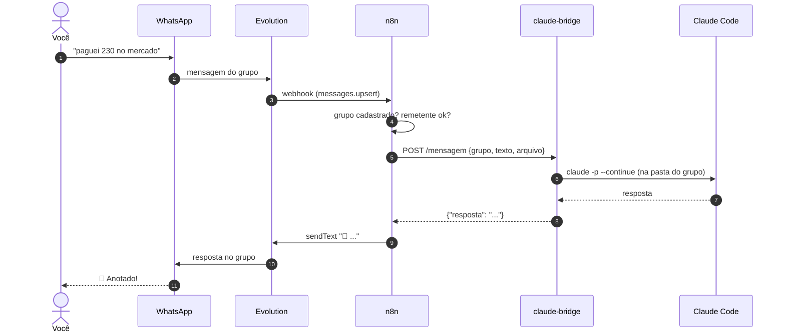
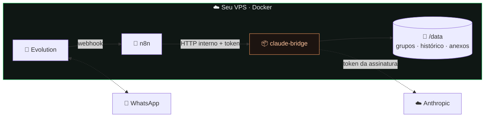

<div align="center">



<br>


**Fale com o Claude Code pelo WhatsApp.** Cada grupo é um assunto, com instruções, memória e permissões próprias.<br>
Roda no seu VPS (Easypanel, Dokploy ou Docker puro), usando a sua assinatura do Claude, sem custo de API.

[**Guia de implantação →**](docs/PLANO.md) &nbsp;·&nbsp; [Grupos](#-grupos-prontos) &nbsp;·&nbsp; [Arquitetura](#-arquitetura) &nbsp;·&nbsp; [FAQ](#-perguntas-rápidas)

</div>

---

## ✨ Como funciona

<p align="center">
  
</p>

| | |
|---|---|
| 💬 **Um grupo, um assunto** | Cada grupo do WhatsApp aponta para uma pasta com seu próprio `CLAUDE.md`. |
| 🧠 **Memória separada** | O histórico de um grupo nunca se mistura com o de outro. `/nova` começa do zero. |
| 📸 **Fotos e documentos** | Mande o print de um comprovante: o Claude lê a imagem e age. |
| 🔒 **Isolado** | O Claude roda num contêiner sem privilégios, sem domínio público, atrás de token. |
| 🧩 **Fácil de expandir** | Novo tipo de conversa = copiar uma pasta e escrever as instruções. |

---

## 🗂 Grupos prontos

<table>
<tr>
<td width="33%" valign="top">

### 🤖 `meu-claude`
Assistente geral no bolso.

```
você: me lembra de renovar
      o seguro em março
🤖 Anotado em notas.md ✅
```
Pesquisa na web · notas

</td>
<td width="33%" valign="top">

### 🔌 `minha-api`
Modelo para registrar numa API sua.

```
você: [foto do comprovante]
🤖 Registrado: Mercado,
   R$ 47,08, hoje.
```
Texto ou foto · token por variável

</td>
<td width="33%" valign="top">

### 🏖 `viagem`
Divide os gastos da viagem.

```
você: quem deve quanto?
🤖 Bruno → você: R$ 57,50
   Carla → você: R$ 57,50
```
CSV · acerto mínimo de contas

</td>
</tr>
</table>

> [!TIP]
> Para criar um novo, copie `_modelo/`, dê um nome (`academia`, `estudos`, `casa`…), escreva o `CLAUDE.md` e cadastre o grupo no n8n. Detalhes na [seção 10 do guia](docs/PLANO.md#10-criar-um-novo-tipo-de-conversa).

---

## 🏗 Arquitetura





---

## 🚀 Começo rápido

<details>
<summary><b>1. Gerar o token do Claude</b> (no seu PC)</summary>

```bash
npm install -g @anthropic-ai/claude-code
claude setup-token
```
Guarde o `sk-ant-oat01-…` só no Easypanel.
</details>

<details>
<summary><b>2. Subir o claude-bridge</b> (Easypanel, Dokploy ou Compose)</summary>

| | Easypanel | Dokploy | Docker Compose |
|---|---|---|---|
| Criar | *+ Service → App* | *Create Service → Application* | `docker compose up -d --build` |
| Código | Build Path `/bridge` | Dockerfile `bridge/Dockerfile` | `docker-compose.yml` |
| Volume | `/data` | `/data` | já incluso |
| Domínio | nenhum | nenhum | sem `ports` |

Variáveis: `BRIDGE_TOKEN`, `CLAUDE_CODE_OAUTH_TOKEN` (e as da sua API, se usar). Detalhes na [seção 5 do guia](docs/PLANO.md#5-passo-3-subir-o-claude-bridge).
</details>

<details>
<summary><b>3. Importar o fluxo no n8n</b></summary>

Importe `n8n/whatsapp-claude.json`, edite o bloco `CONFIG` do nó **Filtrar e montar** (endereços, tokens e a lista de grupos) e ative o workflow.
</details>

<details>
<summary><b>4. Apontar o webhook do Evolution</b></summary>

URL `http://<endereco-do-n8n>:5678/webhook/evolution-claude`, evento **MESSAGES_UPSERT** e **Webhook Base64 ligado**.
</details>

<details>
<summary><b>5. Mandar "oi" no grupo 🎉</b></summary>

A resposta chega começando com 🤖. Se não chegar, o [passo 7 do guia](docs/PLANO.md#9-passo-7-testar) mostra onde olhar.
</details>

> [!IMPORTANT]
> O passo a passo completo, com comandos para cada painel e solução de problemas, está em **[docs/PLANO.md](docs/PLANO.md)**.

---

## 📁 Estrutura

```text
whatsapp-claude-bridge/
├── 📄 docs/PLANO.md             ← comece por aqui
├── 🐳 docker-compose.yml        ← para quem não usa painel
├── 📦 bridge/
│   ├── Dockerfile
│   ├── server.js                ← API (Node, zero dependências)
│   ├── entrypoint.sh
│   └── modelos/grupos/
│       ├── _modelo/             ← base para novos grupos
│       ├── meu-claude/
│       ├── minha-api/
│       └── viagem/
├── 🔀 n8n/whatsapp-claude.json  ← fluxo para importar
└── 🎨 assets/                   ← animações deste README
```

---

## ❓ Perguntas rápidas

<details>
<summary><b>Isso usa a API paga da Anthropic?</b></summary>

Não. O Claude Code usa o token da sua assinatura (`claude setup-token`) e conta nos limites do seu plano.
</details>

<details>
<summary><b>O Claude consegue mexer no meu servidor?</b></summary>

Não. Ele roda num contêiner próprio, com usuário sem privilégios, e só enxerga o volume `/data`. Em cada grupo, o `.claude/settings.json` define o que ele pode usar; o resto é negado.
</details>

<details>
<summary><b>E se outra pessoa mandar mensagem?</b></summary>

O n8n só repassa mensagens de grupos cadastrados e, no modo número separado, só de remetentes liberados. As respostas levam o prefixo 🤖, que é ignorado na volta para não entrar em laço.
</details>

<details>
<summary><b>Corre risco de banimento no WhatsApp?</b></summary>

O Evolution (modo Baileys) usa um protocolo não oficial, que pode violar os termos do WhatsApp. Uso pessoal e com pouco volume reduz o risco, mas não zera. Prefira um número secundário.
</details>

<details>
<summary><b>Áudio funciona?</b></summary>

Ainda não: o Claude avisa e pede texto. A transcrição (Whisper no próprio VPS ou API) está nas [ideias para expandir](docs/PLANO.md#14-ideias-para-expandir).
</details>

<details>
<summary><b>Funciona no Dokploy, Coolify, Portainer…?</b></summary>

Sim. O bridge é um contêiner Docker comum: precisa de um volume em `/data`, das variáveis de ambiente e de estar na mesma rede do n8n. O guia tem o passo a passo para Easypanel, Dokploy e Compose.
</details>

---

## ⚠️ Avisos

- Projeto independente, **sem vínculo** com Anthropic, Meta/WhatsApp, Evolution API ou n8n.
- Use com a **sua** conta do Claude e respeite os termos de cada serviço.
- **Nunca exponha o claude-bridge na internet** e nunca coloque tokens no repositório.

---

<div align="center">
<sub>Projeto da comunidade, sem vínculo com Anthropic, Meta/WhatsApp, Evolution API ou n8n · Licença MIT</sub>
</div>
